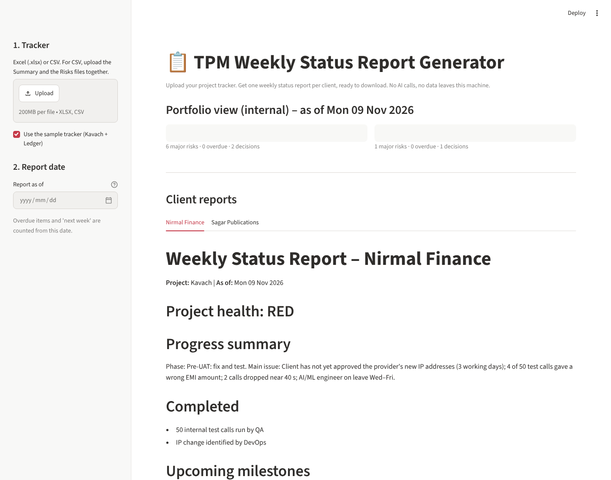

# TPM Weekly Status Report Generator

A small Streamlit app for Technical Program Managers. Upload a project tracker (Excel or CSV) and get **one weekly status report per client**, ready to download. It was built for the PSI take-home scenario, where a Friday client report was missed. The tool makes that report a 30-second job.



**Status (honest):** built with Claude; tested on a Linux sandbox (Python 3.13). 11 unit tests pass. The app was driven in headless Chrome (sample load, file upload, error file, ZIP download) and the report-date picker was checked with Streamlit's test harness. It is **not deployed**, and **not yet pushed to GitHub** (this folder is the repository content).

## Run it

```bash
python -m venv .venv && source .venv/bin/activate     # Windows: .venv\Scripts\activate
pip install -r requirements.txt
streamlit run app.py          # opens http://localhost:8501
python -m pytest -q           # optional: run the tests
```

1. Tick **Use the sample tracker** (Kavach + Ledger), or upload your own `.xlsx` (or two `.csv` files: Summary and Risks).
2. Optionally change **Report as of**. Overdue items and "next week" are counted from this date. If you leave it empty, the date in the tracker title (`As of Mon 9 Nov 2026`) is used, else today.
3. Open a client tab, read the report, download Markdown or HTML (print HTML to PDF), or download all reports as a ZIP.

## Input format

The workbook from Task 5 works as is. The tool finds the header row itself, so a title row above the table is fine.

| Sheet | Needed columns | Optional |
|---|---|---|
| Summary | Project, Client, Status (RAG), Next milestone, Milestone date | Current phase, Main issue, Completed so far, Decision required |
| Risks and Issues | Project, Description, Probability, Impact | ID, Type (Risk/Issue), Risk rating, Owner, Mitigation / action, Due date, Status |
| Milestones (extra sheet) | Project, Milestone, Date | Status |

## How the rules work (no AI inside the tool)

- **One report per row of the Summary sheet.** Risks join to a project by name.
- **Client-safe:** a report only contains items for its own project. Items marked Project = `Both` stay internal and appear in no client report.
- **Health:** the RAG in the tracker. If open items suggest a worse colour (a High item is overdue), the app shows a warning so you can review before sending. If RAG is blank, health is calculated.
- **Rating:** Low/Medium/High from Probability × Impact (1–3 each; 6+ High, 3–4 Medium) if the rating cell is empty.
- **Major risks:** open items rated High. **Blockers:** open High *Issues*. **Overdue:** open items with a due date before the report date.
- **Upcoming milestones:** the Summary milestone, plus any Milestones-sheet rows within 14 days. **Next week:** open items due in the next 7 days.
- **Errors:** wrong file type, empty file, missing sheet/column, unreadable dates and extra files are reported in plain words, never as a traceback.

## Repository structure

```
tpm-status-report-generator/
├── app.py                       # Streamlit interface
├── report_generator/
│   ├── __init__.py
│   └── reporter.py              # load, rules, Markdown/HTML rendering
├── sample_data/sample_tracker.xlsx   # the Task 5 tracker (Kavach + Ledger)
├── tests/test_reporter.py       # 11 tests
├── docs/screenshot.png
├── requirements.txt
└── README.md
```

## Prompts used

Built with Claude (Claude Code environment). The prompt that defined the tool, from the assignment brief:

> **Prompt 1 – the build brief.** "Build a small tool that saves time for a TPM. It reads the tracker from Task 5 (CSV or Excel) and makes a weekly status report for each client: client name, project health, progress summary, completed activities, upcoming milestones, major risks, decisions required, next week's action plan. Highlight blockers, dependencies and actions. Python with Streamlit and Pandas. Easy interface, upload Excel/CSV, client-specific reports, download, sample data, error handling, README. Do not claim it is tested, pushed or deployed unless that happened."

Follow-up steps I asked for during the build: *"Run the app and check the output on the sample data"*, *"Write tests, including one for the bug you just found"*, *"Open the real app in a browser, upload a file, and try a bad file."*

## One error the AI made, and how it was corrected

**What happened.** In the first version, running the tool on the sample tracker produced **six reports instead of two**. Four extra "clients" were called *Status key*, *A committed date or outcome will be missed…*, and so on. The Summary sheet has a small colour legend ("Status key: Red / Amber / Green") under the table, and the AI read those legend rows as projects.

**How I found it.** Not by reading the code: I printed the Markdown for every report, and the headings were nonsense. The AI had assumed that the table runs to the end of the sheet and had used `dropna(how="all")`, which removed the blank separator row, so the legend joined the table.

**The fix.** The table now ends at the first fully blank row (`_frame()` in `reporter.py`). I added a regression test, `test_one_report_per_project_and_no_legend_rows`, and checked the live app again: two tabs, no ghost reports.

*A smaller second error:* the date parser used `dayfirst=True` on ISO text such as `2026-11-12` and Pandas warned. ISO text is now parsed year-first; other text is day-first (Indian style).

## Limits

- Matching of Summary to Risks is by project name; keep names consistent.
- The report text is taken from your cells; the tool does not rewrite or summarise it, so it is only as good as the tracker.
- "Dependencies" are shown through blockers and decisions; the tool does not read text to find dependencies.
